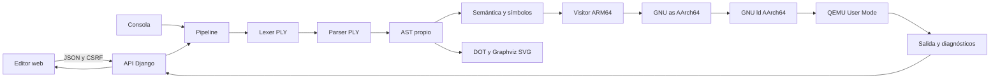
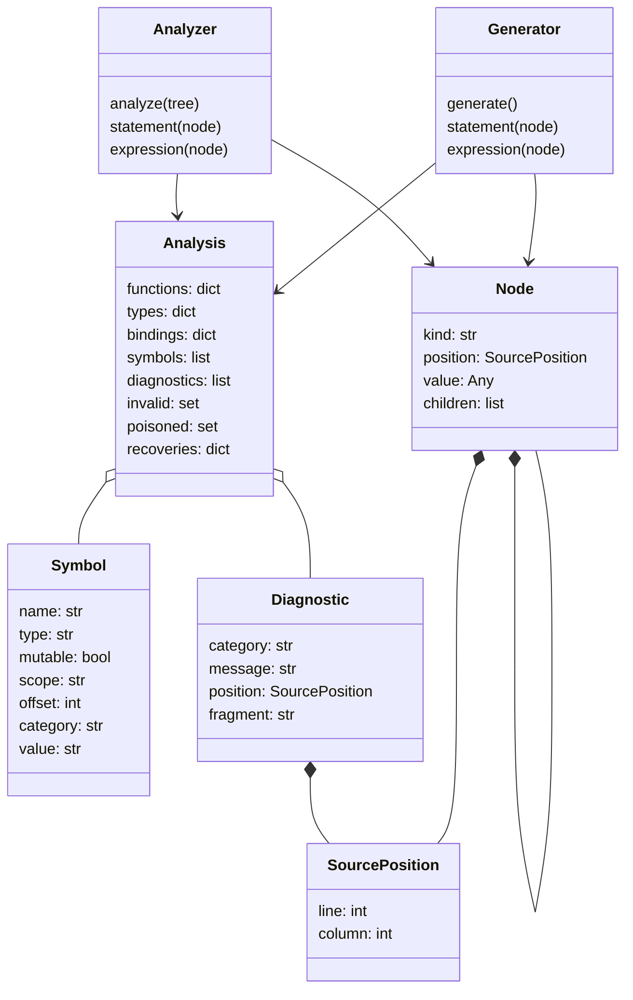

# Manual técnico de OxigenNative

## Arquitectura y responsabilidades

Monolito Django con cliente HTML/CSS/JavaScript. El núcleo del compilador es independiente de Django y también se utiliza desde `python -m compiler`. La ejecución siempre proviene de un binario ARM64 real bajo QEMU; Python analiza y genera código.

## Modelo de clases

## Análisis del lenguaje

La [gramática BNF](gramatica.bnf) documenta las producciones efectivas del parser. Las reglas léxicas se encuentran en `compiler/lexer.py`. Los identificadores admiten letras ASCII, dígitos y guion bajo, con primer carácter no numérico; el lenguaje distingue mayúsculas y minúsculas. Los comentarios de línea y bloque se descartan y conservan las posiciones. Los literales de texto incluyen escapes y raw strings.

La precedencia va de operadores lógicos a comparaciones, suma/resta, multiplicación/división/módulo, unarios y operaciones de acceso/llamada. El parser construye instancias de Node y recupera puntos y coma y llaves faltantes cuando puede continuar. Cada compilación tiene lexer, parser, diagnósticos, tipos y bindings propios.

El analizador registra primero las firmas de funciones para permitir hoisting y recursión mutua. Utiliza una pila de ámbitos para resolver identificadores, permite shadowing y valida tipos, retornos y mutabilidad. Los bindings relacionan un nodo con el símbolo exacto de su declaración. Las funciones se agregan a la tabla de símbolos con categoría Función, los parámetros con categoría Parámetro y las declaraciones con categoría Variable.

## Generación y memoria

El Visitor produce ARM64 directamente, sin código de tres direcciones. Los valores temporales usan x0; los f64 se transportan internamente como bits IEEE-754 y se calculan con registros de punto flotante. Los temporales se guardan en unidades de 16 bytes para mantener la alineación del stack.

Cada función tiene prólogo/epílogo y frame propio. Las llamadas usan x0–x7 para enteros/punteros y d0–d7 para f64; los resultados usan x0 o d0. Se preservan x29 y x30. Los argumentos que exceden los ocho registros de una clase todavía se rechazan.

- **String:** longitud de bytes seguida de contenido UTF-8, incluidos nulos. Las operaciones reservan en un heap de 1 MiB.
- **Arreglo:** descriptor con cantidad y puntero a datos. Las dimensiones fijas se aplanan por filas; este orden coincide con la indexación del lenguaje y mantiene juntas las columnas de una fila.
- **Slice:** descriptor de vista de solo lectura; conserva referencias al bloque original. No copia los datos.
- **Copias:** declaraciones, asignaciones, argumentos y retornos preservan la semántica de valor de los arreglos fijos. Los String contenidos comparten datos inmutables.

Las rutinas de `compiler/runtime/` realizan impresión, asignación de heap, operaciones de cadenas y colecciones, conversiones Unicode por tablas y generación aleatoria mediante getrandom. El programa no depende de libc.

## Recuperación de errores

Los errores estáticos se registran con posición y fragmento. Las operaciones aritméticas incompatibles producen None; las instrucciones sin un valor utilizable, como una impresión de un identificador inexistente, se omiten. Un inicializador incompatible conserva el valor predeterminado del tipo declarado.

Cada instrucción dispone de un checkpoint del stack. Los accesos dinámicos verifican índices y rangos antes de leer o escribir memoria. Si fallan, ARM64 emite un diagnóstico con posición hacia stderr, restaura el checkpoint y salta a la siguiente instrucción válida. El pipeline convierte estos registros en diagnósticos estructurados, separándolos de la salida estándar. No recompila ni ejecuta nuevamente el programa para construir reportes.

La división entre cero, agotamiento de heap y fallos de herramientas se consideran críticos. Cada proceso tiene tiempo y salida acotados, se ejecuta en un directorio temporal propio y su grupo se termina al exceder los límites.

## Contrato HTTP y reportes

`POST /api/compile/` recibe `source` y devuelve success, assembly, diagnostics, ast y symbols. `/api/run/` incorpora executed, stdout, stderr, exit_code y, en caso de fallo, stage. Ambos endpoints añaden elapsed_ms y reports con errores/símbolos HTML, ast_dot, ast_svg y ast_error. `success` es falso si hay diagnósticos, incluso cuando el binario termina con código 0.

Django valida método, JSON, tipos, tamaño UTF-8 y CSRF. El editor obtiene la cookie al abrir `/`. Los datos del compilador se presentan como texto; los HTML exportados escapan contenido y Graphviz recibe únicamente etiquetas DOT escapadas. El SVG se presenta como imagen Blob, sin insertar su código como HTML.

Graphviz se limita a 3,000 nodos, cinco segundos y 8 MiB de salida. Si falla, el resto del resultado sigue disponible. Los reportes de símbolos muestran categorías y valores iniciales literales; no se instrumenta QEMU para capturar valores finales.

## Cliente y estado

El cliente utiliza textarea nativo con capa visual de resaltado, numeración de líneas y atajos. No requiere dependencias JavaScript ni recursos de red externos. Conserva un borrador local y distingue cambios sin guardar y resultados de versiones anteriores. Durante las solicitudes, bloquea la edición para asociar fuente, ensamblador y reportes. La salida se recibe al finalizar la solicitud; no hay streaming.

## Validación y límites conocidos

Ejecuta `python -m pytest -q`, `python manage.py check` y `node --check static/editor.js`. Las pruebas cubren los ocho archivos oficiales, recursión, memoria, recuperación, salida real de QEMU, API, CSRF, escape de reportes y ausencia de Graphviz. Las comprobaciones del navegador se documentan en [verificación de interfaz](verificacion-interfaz.md).

Límites actuales: heap fijo sin recolección, impresión f64 con hasta seis decimales y magnitud menor a 1e12, ocho argumentos por clase de registros, conversiones Unicode por escalar sin reglas contextuales y valores iniciales en la tabla de símbolos. Estos límites se muestran expresamente para no confundir el estado del compilador con cobertura completa de Rust.
