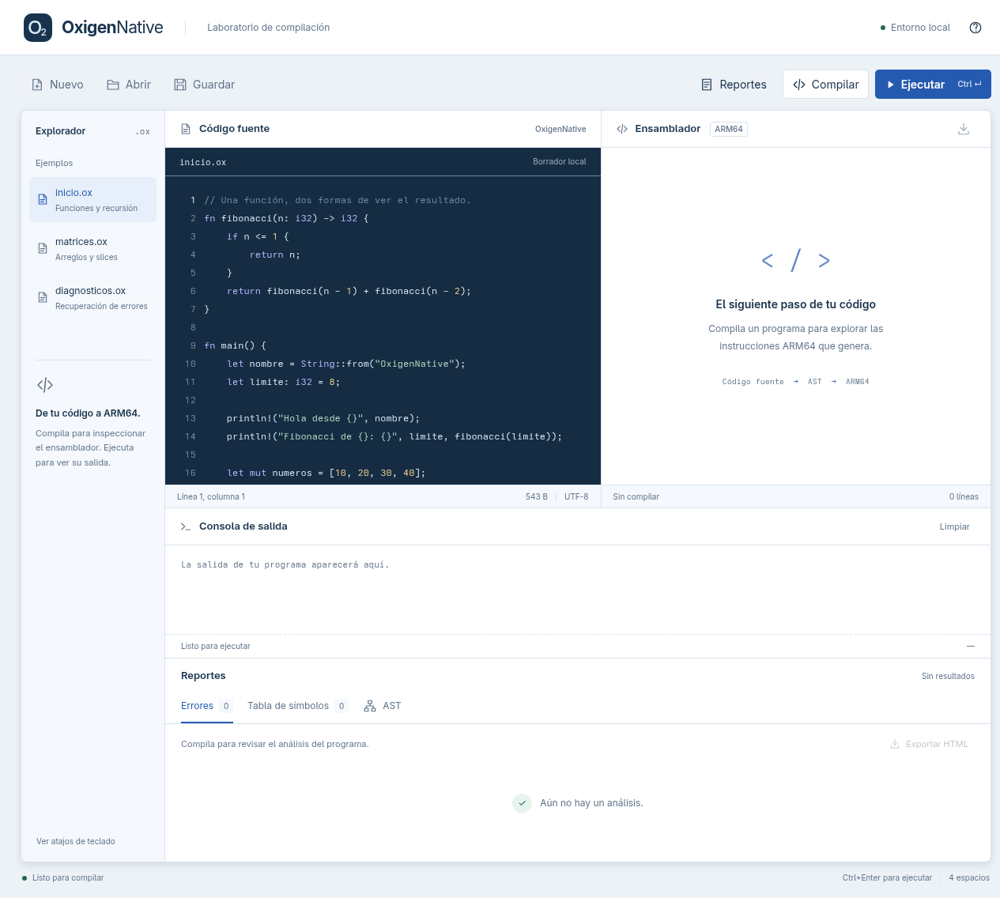
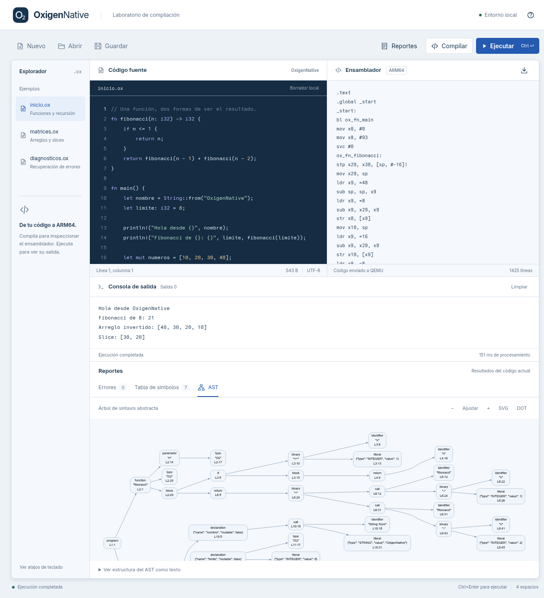

# Manual de usuario de OxigenNative

## Instalación

Se utiliza Linux con Python, PLY, Django, GNU binutils para AArch64, QEMU User Mode y Graphviz. Comprueba las herramientas con:

```sh
python3 --version
command -v aarch64-linux-gnu-as aarch64-linux-gnu-ld qemu-aarch64 dot
```

Desde la raíz del proyecto:

```sh
python3 -m venv .venv
source .venv/bin/activate
pip install -r requirements.txt
python manage.py check
python manage.py runserver
```

Abre http://127.0.0.1:8000/. El servidor de desarrollo es local; no está preparado para recibir programas arbitrarios de Internet. No se necesita base de datos ni un servidor Node para utilizar el editor.

## Espacio de trabajo



El explorador contiene tres ejemplos que puedes editar: funciones/recursión, matrices/slices y recuperación de errores. El área de trabajo reúne código fuente, ensamblador ARM64, consola y reportes. La interfaz se adapta a pantallas pequeñas apilando los paneles.

1. **Nuevo** crea un programa con `fn main()`.
2. **Abrir** carga un archivo local UTF-8; admite archivos `.ox` y `.txt` de hasta 64 KiB. También puedes seleccionar un ejemplo.
3. Edita el código. El editor muestra números de línea, resalta sintaxis y permite indentar con Tab o quitar sangría con Shift+Tab.
4. Cambia el nombre del archivo en la pestaña si lo necesitas. **Guardar** descarga una copia `.ox`; la aplicación no modifica archivos del equipo directamente.

Si reemplazas un archivo con cambios sin guardar, un diálogo te permite conservar la edición y guardarla primero. El borrador se conserva automáticamente en el almacenamiento de este navegador; esto no reemplaza una copia descargada. Si el navegador impide el almacenamiento, el editor y las descargas siguen funcionando. Los borradores recuperables tienen un límite de 1 MiB; el límite de compilación sigue siendo 64 KiB.

## Compilar y ejecutar

**Compilar** realiza el análisis y genera ARM64 y reportes, sin ejecutar QEMU. **Ejecutar** también ensambla, enlaza y ejecuta el binario ARM64. El panel de ensamblador muestra el mismo texto que se entrega a las herramientas del servidor; su botón de descarga guarda un archivo `.s`.

Mientras se procesa una solicitud, el código permanece de solo lectura para mantener la correspondencia entre fuente y resultados. La consola muestra la salida al terminar la solicitud, no mediante streaming. Debajo se informa el tiempo de procesamiento, incluida la generación de reportes, y el código de salida cuando existe.

Un programa puede imprimir salida y terminar con código 0, pero presentar diagnósticos recuperables. En ese caso verás «Finalizado con diagnósticos». Los fallos críticos de las herramientas aparecen en la consola. Cada proceso tiene límites de cinco segundos y 1 MiB de salida.

Al editar después de compilar, los reportes se marcan como pertenecientes a la versión anterior. Vuelve a compilar o ejecutar para actualizarlos; los botones de ubicación evitan navegar a posiciones antiguas.

## Reportes y descargas

- **Errores:** categoría, descripción, fragmento y ubicación. Pulsa la ubicación para enfocar el editor en esa línea y columna. Exportar HTML descarga una tabla independiente que puedes abrir o imprimir.
- **Tabla de símbolos:** variables, parámetros y funciones, con tipo, ámbito, línea y mutabilidad. La columna «Valor inicial» muestra únicamente literales disponibles durante el análisis; «—» indica un valor calculado o no disponible. No representa los valores finales de QEMU.
- **AST:** gráfico generado mediante Graphviz del árbol real del programa. Usa los controles para ajustar el zoom; puedes desplazarte dentro del gráfico y consultar el árbol como texto. Descarga SVG para el gráfico o DOT para su fuente.

El AST y los reportes pertenecen a la misma compilación que la salida; exportarlos no vuelve a ejecutar el programa. Si falta Graphviz, se mantienen los reportes HTML, el DOT cuando está disponible y la estructura textual del AST. El visor gráfico admite hasta 3,000 nodos, cinco segundos de procesamiento y 8 MiB de SVG; superar estos límites muestra un aviso.



## Atajos

| Acción | Atajo |
| --- | --- |
| Ejecutar | Ctrl+Enter / Cmd+Enter |
| Guardar copia | Ctrl+S / Cmd+S |
| Abrir archivo | Ctrl+O / Cmd+O |
| Indentar | Tab |
| Quitar sangría | Shift+Tab |
| Cambiar pestaña de reportes | Flechas, Inicio y Fin al enfocar una pestaña |

## Ejemplo de sesión

Selecciona `inicio.ox` y pulsa Ejecutar. La salida esperada es:

```text
Hola desde OxigenNative
Fibonacci de 8: 21
Arreglo invertido: [40, 30, 20, 10]
Slice: [30, 20]
```

Selecciona `diagnosticos.ox`: la modificación de una variable inmutable se reporta durante el análisis; un índice dinámico fuera de rango se reporta durante QEMU. La instrucción final se ejecuta a pesar de ambos errores.

## Problemas frecuentes

- **No se conecta:** comprueba que `python manage.py runserver` siga activo y que uses el puerto indicado.
- **La sesión expiró:** recarga la página para obtener una nueva cookie CSRF; el borrador se conserva.
- **No aparece el AST:** verifica que `dot` esté instalado; consulta el texto del árbol y descarga DOT mientras tanto.
- **El programa no termina:** revisa bucles o recursión sin caso base. El servidor interrumpe el proceso al llegar al límite.
- **Heap agotado:** reduce el tamaño o la cantidad de cadenas/arreglos temporales; actualmente el heap tiene 1 MiB sin recolección.
- **Impresión f64 fuera de rango:** el formateador actual admite magnitudes menores a 1e12 y hasta seis decimales.

Para ejecutar desde terminal, consulta las instrucciones del [README](../README.md).
